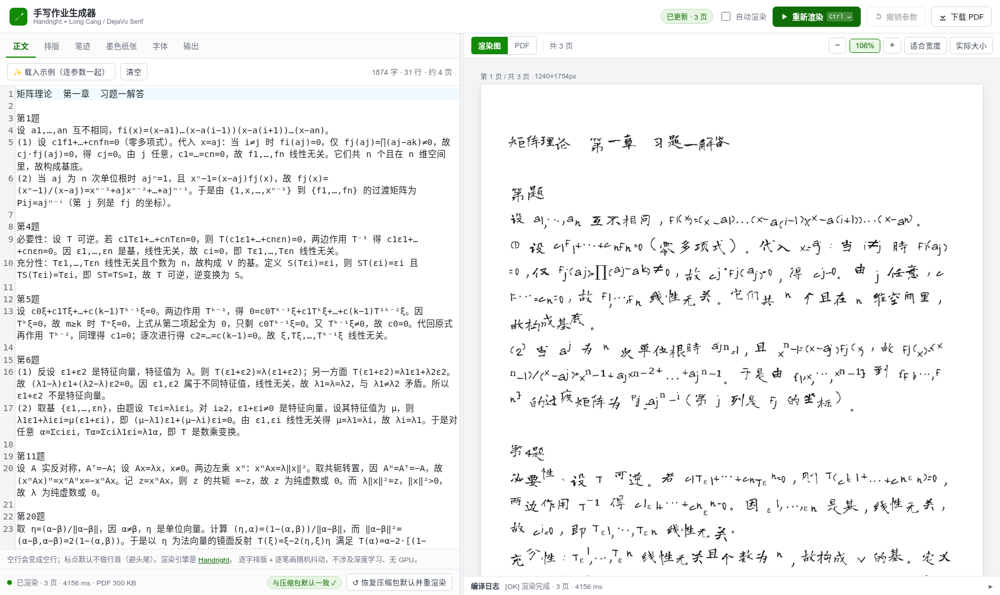
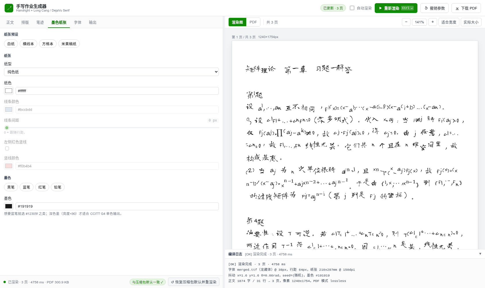

# 手写作业生成器（handwrite）

把一段文字渲染成**看起来像手写**的 A4 PDF：内容完全由你掌控，无需克隆任何人的笔迹，
无 GPU、无模型，纯本地几秒出结果。

```text
纯文本 ──► handwrite render ──► 手写风 PDF（打印出来拍照就能交）
              │
              └─ handwrite serve ──► Overleaf 风格网页版（左侧调参数，右侧看渲染图）
```



## 它解决了什么问题

底层引擎是 [Handright](https://github.com/Gsllchb/Handright)：逐字排版 + **逐笔画**随机扰动，
所以看起来"不整齐"，而不整齐正是手写的核心特征。但它有两个硬伤，这个工具都补上了：

1. **不做字体回退。** 开源中文手写体（Google Fonts 的龙藏体等）几乎都不带
   α β λ ‖·‖² Σ 这类数学符号，直接排数学作业会变方框。
   → 工具用 fontTools 把**手写体 + DejaVu Serif** 合并成 `fonts/merged*.ttf`，缺啥补啥。
2. **输出是纯 1 位像素，没有抗锯齿。** 直接看会笔画发毛、断成虚线（PDF 阅读器显示时
   才做平滑，所以原始 CLI 的 PDF 看着还行，网页预览就露馅了）。
   → 工具默认 **2× 超采样**：按双倍分辨率渲染（字体、行距、边距、所有 σ 同比放大，
   排版完全不变），再 LANCZOS 降回目标尺寸，观感与阅读器一致。

## 快速开始

```bash
cd tools/handwrite

# 1. 装依赖 + 下载 5 款开源手写体 + 合并数学符号（一次性，约 1 分钟）
node cli.mjs setup --with-fonts

# 2. 渲染
node cli.mjs render -i example/homework.txt --preview png
#   → out/homework.pdf（3 页 A4）+ out/homework-p{1,2,3}.png

# 3. 或者开网页版，边看边调
node cli.mjs serve            # http://127.0.0.1:8899
```

也可以从 stdin 喂内容：`cat a.txt | node cli.mjs render -o 作业.pdf`

## 命令行

```text
node cli.mjs render  [选项]      文本 → PDF（可选 PNG 预览）
node cli.mjs preview [选项]      只出 PNG，快速看效果
node cli.mjs serve   [--port N]  网页版（默认 8899）
node cli.mjs fonts   [--fetch --build]  查看 / 重建字体库
node cli.mjs params              打印默认参数（= 原始实现的默认值）
node cli.mjs doctor              体检：python / 依赖 / 字体 / 工具链
node cli.mjs setup   [--force]   建 .venv + 装依赖（--with-fonts 连字体一起）
node cli.mjs test    smoke|parity|ui    跑测试（会按需自动起服务）
```

常用选项：

| 选项 | 默认 | 说明 |
|---|---|---|
| `-i, --input <file>` | stdin | 正文文件 |
| `-o, --out <file>` | `out/<输入名>.pdf` | 输出 PDF |
| `--preview png\|none` | `none` | 是否同时导出每页 PNG |
| `--font <merged-*.ttf>` | `merged.ttf` | 手写体（龙藏体 / 马善政楷书 / 志莽行书 / 刘建毛草 / 站酷小薇） |
| `--params '<json>'` | — | 直接给一坨参数（键名见下表） |
| `--json` | — | 以 JSON 输出结果，方便脚本/agent 读取 |

### 参数表（`--params` 里的键名，单位都是像素）

| 参数 | 默认 | 作用 |
|---|---|---|
| `page_size` | `A4` | A4 / A5 / B5 / Letter |
| `dpi` | 150 | 150dpi 下 A4 = 1240×1754px |
| `margin` | 70 | 四边页边距（≈12mm） |
| `font_size` | 38 | 字号（38px ≈ 18pt ≈ 6.4mm） |
| `line_spacing` | 64 | 行距，**必须 ≥ 字号**（否则自动上调并提示） |
| `line_spacing_sigma` | 4.0 | 基线上下抖动 σ，行越"波浪" |
| `font_size_sigma` | 1.5 | 字号逐字随机 σ（**最吃性能**的项，设 0 更快） |
| `word_spacing` / `word_spacing_sigma` | 1 / 1.5 | 字距与字距抖动 |
| `jitter_x` / `jitter_y` | 1.6 / 1.6 | **每个笔画**的横向/纵向位移 σ |
| `perturb_theta` | 0.06 | 笔画绕自身中心旋转 σ（弧度，0.06 ≈ 3.4°） |
| `seed` | 空 | 填了就复现同一份手写；留空每次不同 |
| `grid_layout` | false | 按等宽格子排版（配方格本更像格子本作业） |
| `ink` | `#191919` | 墨色（`#12305f` 蓝笔、`#8f1d1d` 红笔、`#5a5a5a` 铅笔） |
| `paper` | `blank` | `blank` 纯色纸 / `lined` 横线本 / `grid` 方格本 |
| `paper_color` | `#ffffff` | 纸色（`#fbf6e8` 米黄稿纸） |
| `rule_color` / `rule_spacing` | `#bccbdd` / 0 | 线条颜色 / 间距（0 = 跟随行距） |
| `margin_line` | false | 左侧红色竖线 |
| `start_chars` / `end_chars` | Handright 默认 | 避头尾字符集 |
| `supersample` | **2** | 抗锯齿倍数：1=关闭（硬边最快）/ 2=推荐 / 3=最细腻（约 2 倍耗时） |
| `pdf_mode` | `lossless` | `lossless` 无损 Flate（支持彩色墨）/ `g4` CCITT G4 单色（最小）/ `jpeg` |
| `jpeg_quality` | 88 | 仅 JPEG 模式生效 |

例子：

```bash
# 蓝笔 + 横线本 + 潦草一点
node cli.mjs render -i 作业.txt -o 作业.pdf \
  --ink '#12305f' --paper lined --params '{"margin_line":true,"jitter_x":2.4,"perturb_theta":0.1}'

# 换字体、更工整、固定种子（同样的输入永远出同一份）
node cli.mjs render -i a.txt --font merged-mashanzheng.ttf --seed hw-001 \
  --params '{"jitter_x":0.6,"jitter_y":0.6,"perturb_theta":0.02,"pdf_mode":"g4"}'

# 只要一张预览图
node cli.mjs preview -i a.txt -o /tmp/p.pdf --preview-width 1200
```

## 网页版（Overleaf 风格）

`node cli.mjs serve` 之后打开 <http://127.0.0.1:8899>：

* 左侧 CodeMirror 编辑器写正文，6 个参数标签页（排版 / 笔迹 / 墨色纸张 / 字体 / 输出）
* 右侧逐页渲染图，可缩放 / 适合宽度，也能切到 PDF 视图
* 右上角**手动「重新渲染」**（`Ctrl/⌘+Enter`），另有可选的自动渲染
* 一键预设（工整/自然/潦草/狂草、黑蓝红铅笔、白纸/横线本/方格本/米黄稿纸）
* **对账芯片**：显示当前参数是否与 `reference/handwrite.py` 的默认值一致、偏离了哪几项，
  一键对齐并重渲染
* **撤销参数**（`Alt+Z`）：回到上一次渲染所用的那套参数，最多 12 步
* 底部编译日志条；参数与正文自动存浏览器 localStorage



想在浏览器里传自己的手写体：字体页拖一个 ttf 上去，服务端会当场和 DejaVu Serif 合并
补齐数学符号（约 5 秒），合并结果留在 `fonts/` 里。

## 原理

```text
浏览器 ──POST /api/render──► FastAPI(app.py) ──► render.py ──► Handright ──► 1bit 位图
   ▲                                                                    │
   └──── PNG 预览 / PDF 下载 ◄──── page_to_png / pages_to_pdf ◄── 2× 超采样降采样
```

* **排版 + 抖动（Handright）**：第一遍把文字逐字画到 1 位位图做排版；第二遍做 4 邻域连通域
  标记，把每个**连通笔画**当整体，各自抽 `N(0, σx)`、`N(0, σy)`、`N(0, σθ)` 再绕自身包围盒
  中心旋转，最后以墨色写回背景。全程无抗锯齿 —— 所以需要超采样补平滑。
* **字体合并（fontlib.py）**：清理两个字体的 `MATH/GSUB/GPOS/GDEF` 冲突表 → 统一 UPM →
  `Merger` 合并（同字符冲突时手写体优先）→ 自检 `αβγλΣ∏⊥∈≠‖‖₀₁₂ₙ⁻¹ᴴᵀ∀·` 是否齐全。
* **PDF**：`lossless` 用自写的极小 PDF 写入器（16 色索引 + FlateDecode，保留抗锯齿灰阶和
  彩色墨）；`g4` 交给 Pillow 出 CCITT G4（3 页约 50KB）；`jpeg` 走 DCTDecode。

### 实测数据（150dpi，示例 1874 字）

| | 页数 | 耗时 | PDF 体积 |
|---|---|---|---|
| `reference/handwrite.py`（原始 CLI） | 3 | 1.3s | 529KB |
| 本工具 `supersample=1` | 3 | 1.3s | 301KB |
| 本工具 `supersample=2`（默认） | 3 | 4.0s | 301KB |
| 本工具 + `pdf_mode=g4` | 3 | 4.0s | ~50KB |

墨迹覆盖率：原始 CLI 3.00% vs 本工具 2.87%（同一段文字），即"看起来一样"。

## 与原始实现对账

`reference/` 里保留了最初版本的两个脚本（`handwrite.py` 单文件 CLI、
`build_font.py` 朴素版字体合并），它们是**默认参数的真身**：

```bash
node cli.mjs test parity      # 25 项：解析 reference/handwrite.py 的 argparse 默认值逐项比对
                              # + 真跑一遍 CLI 和引擎，比较页数 / 页面尺寸 / 墨迹覆盖率
```

网页版左下角和参数面板里的「对账芯片」就是这份对照的可视化：
显示 `与压缩包默认一致 ✓` 或 `偏离压缩包默认 N 项`（悬停列出具体项），
旁边按钮一键对齐并重渲染。

## 测试

```bash
node cli.mjs doctor           # 体检（python / 依赖 / 字体 / 可选工具）
node cli.mjs test smoke       # 51 项：接口 + 10 组参数矩阵 + 预览图/PDF + 错误处理 + 种子确定性
node cli.mjs test parity      # 25 项：与 reference/handwrite.py 逐项对账 + 实跑比对
node cli.mjs test ui          # 无头浏览器截图 + UI 回归（需要 playwright，见 tests/screenshot.py）
```

## 已知限制

* 同一字体的同一个字长得一模一样，只是位置/角度不同；这不是深度学习笔迹克隆。
* 抖动太大（`jitter_x/y` > ~3）时相邻字的墨迹可能连成一片、被当成同一坨笔画一起歪。
* `font_size_sigma` 每个字都要重建字体对象，是性能瓶颈；1000 字以内建议 ≤ 2。
* 数学符号用 DejaVu Serif 字形，近距离看比中文略"印刷体"，拍照后基本看不出。
* 超采样默认 2×，单页约 1.5 秒；嫌慢调 `supersample: 1`（代价是笔画发毛）。

## 目录

```text
tools/handwrite/
├── cli.mjs              # 命令行入口（本文件描述的全部命令）
├── engine/server/       # Python 引擎：渲染管线 / 字体库 / FastAPI 服务 / 无头 CLI
├── engine/web/          # 网页版前端（原生 JS + CodeMirror 6，无需构建）
├── reference/           # 最初版本 handwrite.py + build_font.py（默认参数真身）
├── example/homework.txt # 示例正文（矩阵理论习题）
├── tests/               # 冒烟 / 对账 / 截图回归
├── fonts/               # 字体（不入库：fetch_fonts.py 下载 + fontlib.py 合并）
└── out/                 # 渲染产物（不入库）
```

## 许可

* 本工具代码：MIT（随 acp-claw 仓库）
* 手写体：SIL OFL 1.1（Long Cang / Ma Shan Zheng / Zhi Mang Xing / Liu Jian Mao Cao / ZCOOL XiaoWei，均来自 Google Fonts）
* DejaVu Serif：Bitstream Vera / 自由字体许可
* 手写引擎 [Handright](https://github.com/Gsllchb/Handright)：BSD-3-Clause
